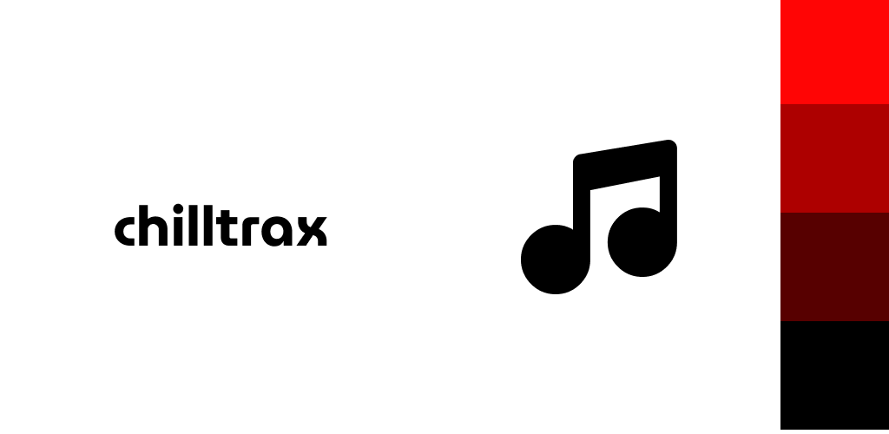
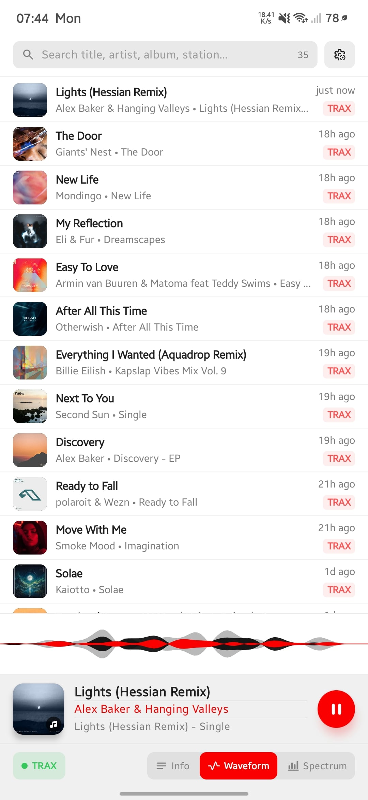
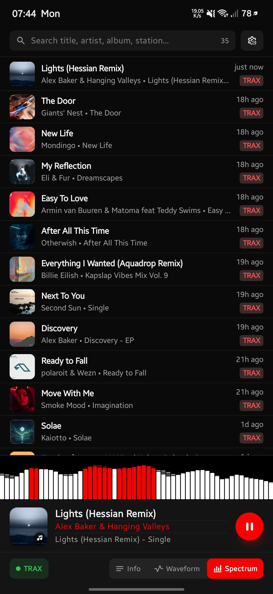

# Chilltrax — Two-Station Android Radio Player (`Chilltrax` & `Radio Danz`)

Light              |Dark
:-----------------:|:---------------:
|

Native Android application (`app_name`: `Chilltrax`, `applicationId`: `com.lucianmarin.trax`) built with **Kotlin** and **Jetpack Compose** (Material 3) for streaming **Chilltrax** ("The World's Chillout Channel") and **Radio Danz** ("The World's Dance Music Channel"). Modeled after the `../chilltrax` macOS app with an **inverted bottom-to-top panel layout**, **single-page settings**, and **Google Fonts Material Symbols** iconography.

---

## Project Specifications

### 1. Inverted Panel Layout (Bottom to Top)
The main player screen stacks its four panels from bottom to top:
1. **Bottom — App Controls Bar**:
   - **Radio Station Status Text Badge** (left): Displays `READY`, `TRAX` (when Chilltrax is playing), `DANZ` (when Radio Danz is playing), `PAUSED`, `LOADING`, or `ERROR`. Tapping while `TRAX` or `DANZ` is shown immediately switches between Chilltrax and Radio Danz; tapping any other status opens Settings.
   - **Segmented Visualizer Mode Tabs** (center): Three segments for:
     - **No Info / Off**: Hides the visualizer panel (`notes` / `format_align_left` icon).
     - **Waveform Visualizer**: Uses the Google Fonts Material Symbols **Vital Signs** (`vital_signs`) icon.
     - **Spectrum Visualizer**: Uses the Google Fonts Material Symbols **Bar Chart 4 Bars** (`bar_chart_4_bars`) icon.
   - **Settings Button** (right): Replaces the macOS history toolbar button (which featured the results counter) with the Google Fonts Material Symbols **Settings Slow Motion** (`settings_slow_motion`) icon button, opening the single-page Settings view.
2. **Above App Controls — Current Song Info Card**:
   - **60×60 dp Album Cover Artwork**: Displays cached/live track artwork or the `icon.svg` radio wave branding with the Google Fonts Material Symbols **Music Note 2** (`music_note_2`) icon (replacing the Apple logo). Tapping while playing opens the song on Apple Music (`buyURL` or `music.apple.com` search).
   - **Track Metadata**:
     - **Title** (16sp bold, 1 line): Tapping while playing copies `"Artist - Title"` to the clipboard and highlights the matching history item badge as `COPY`.
     - **Artist** (13sp medium, `#FA0000` red when playing): Tapping while playing copies `"Artist - Title"` to the clipboard.
     - **Album / Mix** (11sp secondary, 1 line).
   - **Play / Pause Button**: 44×44 dp `#FA0000` red circle button with white play/pause icon.
3. **Above Current Song Info — Audio Visualizer Panel**:
   - Full-bleed 68 dp tall real-time 56-bar audio visualizer synced to playback intensity (or collapsed to `0 dp` when the **No Info / Off** segment is selected).
   - **Waveform (`Vital Signs`)**: Multi-ribbon layered sine waveform (`#808080` gray outer ribbon, black/white contrast mid ribbon, `#FA0000` red core ribbon).
   - **Spectrum (`Bar Chart 4 Bars`)**: 56 vertical bars with trailing peak decay (`#808080` gray for low < 28%, black/white contrast for mid 28%–72%, `#FA0000` red for high ≥ 72%).
4. **Top — Search Bar & Song History Results**:
   - **Search Bar**: Filters recorded history across artist, title, album/mix, year, station name, and `TRAX`/`DANZ` badge with instant match counter and clear button.
   - **Playable / Actionable History List**: Displays recorded songs (newest first, paginated 50 at a time with full-history search), 36×36 dp cached album cover or **Music Note** (`music_note`) icon placeholder, relative timestamp, `TRAX` / `DANZ` / `COPY` station badge, tap row to copy `"Artist - Title"` to clipboard, and tap cover to open on Apple Music.

### 2. Single-Page Settings
All application settings are consolidated into a **single scrollable page** (instead of two tabs on macOS):
- **Radio Station**: Segmented selector for **Chilltrax** (`TRAX`) and **Radio Danz** (`DANZ`).
- **Active Broadcast Stream**: Stream selector across discovered/built-in streams for the active station, displaying the active **Stream URL** and **Song Info API** endpoint, plus custom stream addition.
- **Broadcast Discovery**: **Find Broadcasts** button (`chilltrax.com` & `radiodanz.com`) that scrapes live stream URLs, `.pls` playlists, and JSON API endpoints (`GetSongInformation`, `GetCoverImage`, `GetLastTen`).
- **Metadata & Artwork**:
  - Toggle: *Display and fetch album covers* (with iTunes Search API fallback for Radio Danz).
- **Covers Cache & History File**:
  - *Commit Song After Playing*: Stepper / numeric input (`0`–`99` seconds, default `10` seconds).
  - Storage metrics: *Recorded Songs* count, *Album Covers Cache Size*, *Compressed History Size* (`history.tsv.gz`), and *Storage Path*.
  - *Clear Cache & History* button.

### 3. Iconography & App Icon
- **App Launcher Icon**: Generated directly from `white.svg` as Android adaptive launcher icons (`ic_launcher_background.xml`, `ic_launcher_foreground.xml`, `ic_launcher_monochrome.xml`) with the exact `#FFFFFF` left 3/4 panel, right 1/4 four-tier vertical color blocks (`#FF0505`, `#AD0000`, `#570000`, `#000000`), and black `music_note_2` symbol.
- **Google Fonts Material Symbols**:
  - `music_note_2` (**Music Note 2**): Replaces the Apple logo on the default station artwork and album cover action overlay.
  - `music_note` (**Music Note**): Used for song history results placeholder artwork.
  - `bar_chart_4_bars` (**Bar Chart 4 Bars**): Used for the Spectrum visualizer segment.
  - `vital_signs` (**Vital Signs**): Used for the Waveform visualizer segment.
  - `settings_slow_motion` (**Settings Slow Motion**): Used for the Settings button in the bottom app controls bar.

### 4. Android Media Playback Controls & Background Play
- **Foreground Media Service (`RadioPlaybackService`)**: Runs with `foregroundServiceType="mediaPlayback"`, `PARTIAL_WAKE_LOCK`, and low-latency `WifiLock` so streaming continues uninterrupted when the app is backgrounded or the screen is locked.
- **System `MediaSession` & `Notification.MediaStyle`**:
  - Integrates with the Android notification shade, lock screen media player, Bluetooth car/speaker displays, and hardware headset buttons.
  - Exposes live track title, artist, album/mix, station badge (`TRAX • Chilltrax` / `DANZ • Radio Danz`), and cached album cover artwork.
  - **Transport Actions**: Play, Pause, Stop, and Skip Next / Skip Previous (switches between **Chilltrax** and **Radio Danz** directly from the lock screen, notification, or headset controls).
- **Audio Focus & Becoming Noisy**:
  - Requests `AUDIOFOCUS_GAIN` (`USAGE_MEDIA`, `CONTENT_TYPE_MUSIC`), automatically ducking on transient alerts and pausing/resuming around phone calls or other media apps.
  - Listens for `AudioManager.ACTION_AUDIO_BECOMING_NOISY` to pause playback when headphones or Bluetooth audio disconnect.

---

## Implementation Tracker

- [x] Track project specifications in `README.md`
- [x] Copy `../chilltrax/icon.svg` and generate Android adaptive icon drawables
- [x] Configure Gradle project (`applicationId = "com.lucianmarin.trax"`, `AGP 9.5.1`, `Kotlin 2.2.10`, Jetpack Compose Material 3, Coroutines, Kotlinx Serialization, OkHttp)
- [x] Implement Google Fonts Material Symbols vector icons (`music_note_2`, `music_note`, `bar_chart_4_bars`, `vital_signs`, `settings_slow_motion`)
- [x] Implement data models (`RadioStation`, `VisualizerMode`, `StationStream`, `StationAPIEndpoints`, `SongMetadata`, `SongHistoryEntry`)
- [x] Implement `ChilltraxClient` (now playing, cover art, last 10, HTML broadcast/API discovery, `.pls` parser, iTunes cover search)
- [x] Implement `CompressedHistoryStore` & `AlbumCoverCache`
- [x] Implement `RadioPlayer` (Android `MediaPlayer` streaming + 56-bar spectrum/waveform synthesizer)
- [x] Implement Android `MediaSession`, `Notification.MediaStyle`, audio focus, and background playback via `RadioPlaybackService`
- [x] Implement `AppState` state management & persistence
- [x] Implement Jetpack Compose UI with inverted bottom-to-top panel order and single-page Settings view
- [x] Write and pass unit tests (`./gradlew testDebugUnitTest assembleDebug`)

Chilltrax radio for Android.
